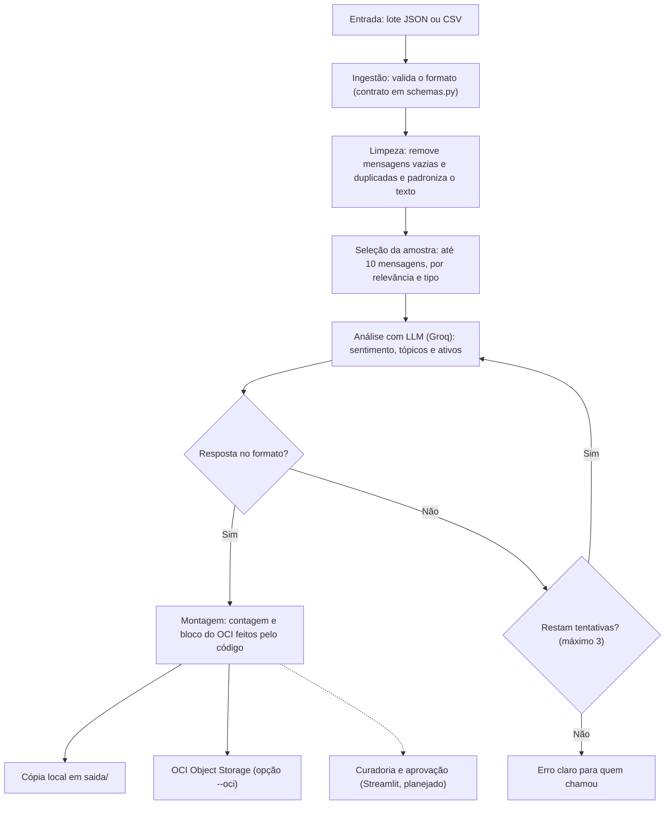

# G10-Brasil-equipe12-CommunityLab

## CommunityLab 🤖💬

> Motor Inteligente de Transformação e Distribuição para Comunidades Digitais

**Hackathon ONE G10 · Oracle Next Education & Alura · Equipe G10-BRASIL-equipe 12**

<!--
  README ÚNICO: junta o que estava nos PRs #4, #6 e #9, o esqueleto de seções e as decisões do time.
  Comentários como este não aparecem no GitHub. Seções com 🚧 ainda não têm conteúdo.
  Nunca colocar chaves de API, e-mails pessoais ou dados da conta OCI: o repositório é público.
-->

---

## 📝 1. Visão Geral do Projeto

O **CommunityLab** é um motor que lê as conversas de uma comunidade digital (por exemplo, no Discord), entende o que está acontecendo nelas e transforma as melhores histórias e dúvidas em conteúdos prontos para publicar, como posts de LinkedIn, destaques de newsletter e dicas de FAQ.

Os resultados são salvos no **OCI Object Storage** (camada Always Free) e passam por uma interface de curadoria, onde uma pessoa revisa antes de publicar.

Este projeto responde ao desafio **"Projeto 3 – CommunityLab"** do Hackathon ONE G10.

## 🚨 2. O Problema

Comunidades digitais geram todos os dias histórias inspiradoras, dúvidas recorrentes e feedbacks valiosos. A maior parte desse valor se perde no histórico dos canais, porque a curadoria e a produção manual de conteúdo consomem muitas horas das equipes de Community Management e de Marketing.

## 🎯 3. Objetivos do MVP

Requisitos mínimos do desafio:

- [ ] Ingestão funcional de interações da comunidade (mensagens, CSV ou JSON simulando canais)
- [ ] Análise de sentimento e extração de tópicos com LLM
- [ ] Geração automatizada de pelo menos 2 formatos de ativos de marketing
- [ ] Orquestração do fluxo com Python ou ferramenta equivalente
- [ ] Integração ativa com o OCI Object Storage (camada Always Free)
- [ ] Demonstração de no mínimo 3 exemplos de transformação de interações em ativos
- [ ] Repositório no GitHub com documentação e diagrama da esteira de distribuição

## 👥 4. Público-Alvo e Casos de Uso

**Setor:** MarTech, gestão de comunidades digitais, marketing de conteúdo e engajamento.

**Quem se beneficia:** comunidades de aprendizagem, ecossistemas de desenvolvedores, empresas SaaS e criadores de conteúdo. No dia a dia, quem usa são as equipes de Community Management e de Marketing.

**Casos de uso do MVP:**

| Quando a mensagem é... | O sistema gera... |
| :--- | :--- |
| Um depoimento ou conquista | **Case de Sucesso:** post de LinkedIn e destaque de newsletter |
| Uma dúvida técnica | **Dica ou FAQ**, encaminhada para mentoria |
| Um feedback | Entra nas **métricas gerais** de satisfação |

## ⚙️ 5. Arquitetura do Pipeline e Fluxo dos Dados

O fluxo de dados do **CommunityLab** segue estas etapas:



### Etapas e situação atual

| # | Etapa | O que faz | Módulo | Situação |
| :-: | :--- | :--- | :--- | :--- |
| 1 | Ingestão e validação | Lê o lote (JSON ou CSV) e confere o formato; informa o campo errado | `src/ingestao.py`, `src/schemas.py` | ✅ Pronto |
| 2 | Limpeza | Remove mensagens vazias e duplicadas, padroniza o texto e preserva o `id` | `src/limpeza.py`, `src/relevancia.py` (pontuação de 0 a 100; em lotes grandes escolhe a amostra enviada à LLM) | ✅ Pronto |
| 3 | Análise com LLM | Pede à LLM sentimento, tópicos e os ativos, em JSON, com nova tentativa se vier fora do formato | `src/prompts.py`, `src/ia_service.py`, `src/validacao.py`, `src/utils/prompt_loader.py` (guias em `prompts/`, com regras e exemplos few-shot) | ✅ Pronto |
| 4 | Resumo e roteamento | A LLM decide quais ativos gerar pelas regras do prompt; o código monta a contagem e o bloco do OCI | `src/prompts.py`, `src/schemas.py` (`montar_resposta`) | ✅ Pronto |
| 5 | Geração de ativos | Gera post de LinkedIn, destaque de newsletter e sugestão de FAQ, cada um com o tom do canal (`null` quando não há material) | Mesma chamada da etapa 3 | ✅ Pronto |
| 6 | Curadoria e aprovação | Uma pessoa revisa e aprova na interface | Streamlit | 📝 Planejado |
| 7 | Armazenamento | Salva o pacote final no bucket da OCI | `src/oracle_storage.py`, `src/pipeline.py` (opção `--oci`) | ✅ Ligado ao pipeline e testado com upload real (confirmado no console em 27/10/2026) |

O formato de dados (entrada e saída) está definido em um só lugar, `src/schemas.py`, e todos os módulos usam esses modelos. A resposta da LLM é validada em `src/validacao.py`, **sem valores de segurança falsos**: se a LLM responder fora do formato, o erro é informado em vez de gerar conteúdo inventado com `status: "sucesso"`.

**Guias de tom de voz e exemplos (few-shot):** os arquivos `prompts/linkedin.md`, `prompts/newsletter.md` e `prompts/faq.md` definem o tom de cada canal, as regras de fidelidade (só fatos das mensagens, proposta não é contratação, não atribuir causas que a pessoa não disse, usar os verbos do relato) e exemplos de entrada e saída. O código carrega os três, junta ao prompt do sistema e termina com um lembrete de precedência. Os exemplos mostram só estilo e estrutura: a LLM não deve copiar nomes nem fatos deles.

**Limite de tamanho:** no plano gratuito da Groq, o modelo atual aceita 8.000 tokens por minuto (limite informado pelo erro 413 de 29/10/2026). Como os guias com exemplos ocupam boa parte disso, o pipeline envia à LLM no máximo **10 mensagens**, escolhidas por relevância e tipo (5 relatos, 3 dúvidas e 2 outras). O `total_interacoes_processadas` continua sendo o do lote inteiro, mas o sentimento e os tópicos refletem a amostra. A opção `--limite` muda o valor.

**Ponto de entrada único:** a função `processar_lote(lote)`, em `src/pipeline.py`, executa as etapas 1 a 5 (e a 7, com `salvar_oci=True`). Assim, tanto uma API quanto o Streamlit podem chamar a mesma lógica, e dá para testar sem subir servidor.

**Decisão de orquestração:** o fluxo é orquestrado em Python puro, pela função `processar_lote()`. O desafio pede orquestração "com Python ou ferramenta equivalente", e esta escolha cumpre o requisito com o menor custo de manutenção para um MVP. Servidor de API, fila de tarefas e workers (por exemplo FastAPI, Celery e Redis) exigiriam infraestrutura nova, com hospedagem, segurança, testes e manutenção contínua, e ficam como evolução futura. Como `processar_lote()` não depende de interface, essas camadas poderão chamá-la depois sem reescrever o motor.

```python
from src.ingestao import ler_mensagens_comunidade
from src.pipeline import processar_lote

lote = ler_mensagens_comunidade("dados/mensagens_exemplo.json")
resposta = processar_lote(lote)   # envio ao OCI só com salvar_oci=True
print(resposta.para_dict())       # dicionário no formato de saída do desafio
```

Pela linha de comando: `python -m src.pipeline` (veja o guia da seção 12).

**Quando algo falha:**

| Problema | Reação |
| :--- | :--- |
| Lote fora do formato | A validação recusa e informa qual campo está errado (✅ implementado) |
| Mensagem vazia | A limpeza descarta (✅ implementado); se nenhuma sobrar, o pipeline avisa |
| Mensagem duplicada | A limpeza descarta e mantém só a primeira ocorrência: mesmo autor, mesmo canal e mesmo texto, sem diferença de espaço ou de maiúscula. O mesmo texto de autores ou canais diferentes não é duplicata (✅ implementado) |
| Lote com mais de 10 mensagens | A LLM analisa uma amostra de até 10, escolhida por relevância e tipo (`--limite` muda o valor). O total do lote inteiro vem na resposta, mas o sentimento e os tópicos refletem a amostra, e o terminal avisa quando isso acontece (✅ implementado) |
| Erro 413 da Groq (pedido grande demais) | A mensagem repassa o erro da Groq, que informa o limite e o tamanho pedido. Use um `--limite` menor (✅ mensagem clara) |
| A LLM responde fora do formato JSON | Valida, tenta de novo até 3 vezes contando à LLM o motivo da recusa e, se continuar falhando, devolve um erro claro. A análise é do lote inteiro, não mensagem a mensagem (✅ implementado) |
| Chave ou serviço da LLM com problema | Mensagem de erro clara (✅ implementado) |
| A LLM inventa ou exagera fatos | Regras no prompt: só usar fatos das mensagens, não inflar conquistas (proposta não é contratação) e não citar o autor de relatos de dificuldade pessoal. **Não elimina o risco**: por isso a curadoria humana antes de publicar |
| Falha ao salvar na OCI | `salvar_no_oci` devolve `status: falha_ao_salvar` e o tipo do erro, sem expor dados da configuração; a análise não se perde (✅ implementado) |

**Fica para depois do MVP:** RAG e embeddings, execução diária automática (cron), Webhook do Discord, geração de imagens e deploy completo.

## 🛠️ 6. Tecnologias Utilizadas

### Decisões do time (registradas em 21/10/2026)

- **Modelo (LLM):** GPT-OSS 120B (`openai/gpt-oss-120b`), da OpenAI
- **Provedor:** Groq (plano gratuito, com limite de tokens por minuto: veja "Limite de tamanho" na seção 5)
- **Interface:** Streamlit

| Parte | Tecnologia | Situação |
| :--- | :--- | :--- |
| Linguagem | Python | Em uso |
| Modelo de IA | `openai/gpt-oss-120b` | Em uso no pipeline |
| Provedor do modelo | Groq (biblioteca `groq`) | Em uso no pipeline |
| Variáveis de ambiente | `python-dotenv` | Em uso |
| Interface de curadoria | Streamlit | Decidido, ainda não implementado |
| Armazenamento | OCI Object Storage (camada Always Free), via SDK Python `oci` | Ligado ao pipeline (opção `--oci`) e testado com upload real |
| Contrato de dados | Pydantic (`src/schemas.py`) | Em uso |
| Dependências | `requirements.txt` (`groq`, `python-dotenv`, `oci`, `pydantic`) | Em uso |
| Previstos no desenho do time | FastAPI, Pandas e LangChain | Ainda não usados no código |
| Versionamento | GitHub, com branches e Pull Requests | Em uso |

> Usamos **somente recursos da camada Always Free** da OCI, conforme exige o programa ONE.

## 📊 7. Mapeamento e Tipos de Mensagem (Dataset)

O motor categoriza as interações da comunidade em 5 tipos:

| Tipo | Descrição |
| :--- | :--- |
| `depoimento` | Relatos de conquistas, aprovações em vagas e casos de sucesso dos alunos |
| `pergunta_tecnica` | Dúvidas sobre código, frameworks (LangGraph, OCI, Gemini) ou infraestrutura |
| `feedback` | Sugestões, elogios e críticas sobre a dinâmica do programa |
| `interacao_geral` | Debates espontâneos e conversas informais nos canais (também é o tipo padrão quando o campo vem vazio) |
| `entrega_projeto` | Entregas e lançamentos de projetos dos alunos |

**Arquivos de dados:**

- [`dados/mensagens_exemplo.json`](dados/mensagens_exemplo.json): mensagens de exemplo
- [`dados/dataset_simulado.json`](dados/dataset_simulado.json): 50 mensagens simuladas (veja [`docs/dataset_simulado.md`](docs/dataset_simulado.md))
- [`dados/caso_proposta_estagio.json`](dados/caso_proposta_estagio.json): lote pequeno com uma proposta de estágio e um freela, sem pergunta técnica
- [`dados/caso_teste_few_shot.json`](dados/caso_teste_few_shot.json): lote pequeno com mensagens que não estão nos exemplos few-shot, para conferir se a LLM generaliza em vez de copiar
- [`dados/casos_demo.json`](dados/casos_demo.json): casos de demonstração, incluindo dados com sujeira (mensagem vazia, repetida, com erros de digitação, com ruído e texto curto e ambíguo)
- [`docs/resultados_esperados.md`](docs/resultados_esperados.md): tabela de resultados esperados dos casos de demonstração

Em `dados/casos_demo.json`, `tipo` é o campo lido pelo motor e `tipo_esperado` fica como gabarito. O motor ignora campos extras de teste (como `cenario` e `tipo_esperado`).

## 📋 8. Formato de Entrada e Ingestão (JSON / CSV)

O arquivo de entrada tem uma origem, um período e uma lista de interações:

```json
{
  "origem_comunidade": "Discord_Grupo_ONE_G10",
  "periodo_referencia": "Semana_04",
  "interacoes": [
    {
      "autor": "Mariana Souza",
      "canal": "#conquistas-e-vagas",
      "tipo": "depoimento",
      "texto": "Pessoal, passei no processo seletivo para Desenvolvedora Júnior de IA!"
    }
  ]
}
```

| Campo | O que é |
| :--- | :--- |
| `origem_comunidade` | De onde vieram as mensagens |
| `periodo_referencia` | Período analisado |
| `autor` | Quem escreveu |
| `canal` | Canal de origem |
| `tipo` | Um dos tipos da seção 7 |
| `texto` | Conteúdo bruto da mensagem |

Em **CSV**, as colunas são `autor`, `canal`, `tipo` e `texto` (a coluna `id` é opcional). Como o CSV não traz origem nem período, eles assumem `Discord_CSV_Import` e `Semana_Atual`.

O campo `id` de cada interação também é opcional; quando existe, é preservado na limpeza. O lote precisa ter pelo menos uma interação, e um `tipo` fora dos 5 da seção 7 é recusado com o nome do campo.

### Formato de saída

A resposta segue o formato do desafio:

```json
{
  "status": "sucesso",
  "resumo_comunidade": {
    "total_interacoes_processadas": 2,
    "sentimento_predominante": "Altamente Positivo",
    "topicos_principais": ["Conquistas", "LangGraph"]
  },
  "ativos_distribuicao_gerados": {
    "post_linkedin": { "titulo": "...", "copy": "...", "canal_recomendado": "LinkedIn Oficial", "potencial_engajamento": "Alto" },
    "destaque_newsletter_semanal": { "secao": "Vitória da Semana", "chamada": "...", "resumo": "..." },
    "sugestao_conteudo_faq": { "tema": "Dica Rápida: ...", "origem": "...", "status": "encaminhado_para_mentoria" }
  },
  "armazenamento_oci": {
    "bucket": "communitylab-ativos-marketing",
    "caminho_objeto": "ativos/2026-semana-04/pacote-distribuicao.json",
    "status": "pendente_upload"
  }
}
```

| Campo | Quem preenche | Observação |
| :--- | :--- | :--- |
| `total_interacoes_processadas` | O código | Conta as interações do lote inteiro que sobraram depois da limpeza, mesmo quando a LLM analisa só uma amostra |
| `sentimento_predominante` | A LLM | Um destes: `Altamente Positivo`, `Positivo`, `Neutro`, `Negativo`, `Altamente Negativo` |
| `topicos_principais` | A LLM | Lista de temas curtos |
| `post_linkedin`, `destaque_newsletter_semanal`, `sugestao_conteudo_faq` | A LLM | Cada um vem `null` quando o lote não tem material para ele (por exemplo, sem pergunta técnica não há FAQ) |
| `potencial_engajamento` | A LLM | `Alto`, `Médio` ou `Baixo` |
| `armazenamento_oci` | O código | `pendente_upload` (rodou sem `--oci`: o pacote foi só para `saida/`), `salvo_com_sucesso` ou `falha_ao_salvar` (com `detalhe_erro`) |

Ao usar a resposta no código, chame `resposta.para_dict()`: ele devolve `copy` (e não `copy_`) e é o formato que deve ser impresso, salvo no OCI ou mostrado no Streamlit.

<!-- O desafio lista como formas de ingestão: JSON, CSV, Webhook ou integração com plataformas.
     A versão anterior citava PDF como entrada. Confirmar se era intencional antes de incluir. -->

## 🔄 9. Exemplos de Transformação (antes → depois)

Três transformações reais, com a mensagem original, a análise e os ativos gerados, estão em [`docs/exemplos_transformacao.md`](docs/exemplos_transformacao.md):

| # | Entrada | Saída | O que mostra |
| :-: | :--- | :--- | :--- |
| 1 | Um depoimento (Mariana) e uma entrega de projeto (Rafael) | Post de LinkedIn e destaque de newsletter | Uma conquista vira dois formatos, cada um com o tom do canal |
| 2 | Uma proposta de estágio (Gustavo) e um freela fechado (Henrique) | Post de LinkedIn e destaque de newsletter; FAQ `null` | Fidelidade aos fatos (proposta não vira contratação) e ausência de ativo quando não há material |
| 3 | Uma dúvida técnica (Rafael Tavares) | Sugestão de FAQ encaminhada para a mentoria | Dúvida recorrente vira tópico de FAQ rastreável |

As saídas são reais e os dados, simulados. A LLM varia entre execuções, por isso a revisão humana antes de publicar faz parte do fluxo.

## 🖥️ 10. Interface de Curadoria e Validação

A interface será feita em **Streamlit**. A ideia é mostrar o resumo da comunidade (sentimento e tópicos), os conteúdos gerados e permitir que uma pessoa revise e aprove antes de publicar.

🚧 em construção (previsto para a Sprint 4)

## ☁️ 11. Armazenamento na Nuvem (Oracle Cloud - OCI)

Os pacotes de conteúdo gerados são salvos em um bucket do **OCI Object Storage**, na camada **Always Free**, em arquivos JSON organizados por período. Padrão de caminho do exemplo do desafio:

```
ativos/2026-semana-04/pacote-distribuicao.json
```

**Como funciona (`src/oracle_storage.py`):**

1. A função `salvar_no_oci(pacote, periodo_referencia)` lê a configuração da OCI de um arquivo **fora do repositório** (padrão `~/.oci/config`).
2. Conecta ao Object Storage pelo SDK Python (`oci`) e descobre o namespace da conta.
3. Grava o pacote em JSON no caminho do período (`Semana_04` vira `ativos/2026-semana-04/pacote-distribuicao.json`).
4. Devolve o bloco `armazenamento_oci` (`bucket`, `caminho_objeto` e `status`). Em caso de erro, devolve `status: falha_ao_salvar` e o tipo do erro, sem dados da configuração.

**Variáveis opcionais** no `.env` (valores padrão entre parênteses): `OCI_BUCKET` (`communitylab-ativos-marketing`), `OCI_CONFIG_FILE` (`~/.oci/config`) e `OCI_PROFILE` (`DEFAULT`).

**No pipeline:** `processar_lote(lote, salvar_oci=True)` (ou `python -m src.pipeline --oci`) chama `salvar_no_oci` e coloca o resultado em `armazenamento_oci`. O arquivo enviado ao bucket é o pacote sem esse bloco. Se o envio falhar, a análise não se perde: o motivo aparece no próprio bloco (`status: falha_ao_salvar`).

> **Cuidado:** enviar sobrescreve o objeto do período. Por isso o envio só acontece com `--oci` (ou `salvar_oci=True`), e os testes devem usar um período de teste (`--periodo Semana_Teste`), nunca `Semana_04`.

**Estrutura no bucket** (partição por período, para isolar cada semana e facilitar a auditoria):

```
communitylab-ativos-marketing/   (bucket)
└── ativos/
    └── {ano}-{periodo}/         (ex.: 2026-semana-teste)
        └── pacote-distribuicao.json
```

**Situação:** a função `salvar_no_oci` foi testada com upload real no bucket, e o pipeline completo também, com o comando `python -m src.pipeline dados/caso_proposta_estagio.json --oci --periodo Semana_Teste`. O teste usou um período de teste, então não sobrescreveu o pacote de nenhuma semana real.

**Evidência:** a captura do console mostra o objeto `ativos/2026-semana-teste/pacote-distribuicao.json` (1,31 KiB, modificado em 27/10/2026, 15:53 UTC): [`docs/evidencias/oci_bucket_2026-semana-teste.png`](docs/evidencias/oci_bucket_2026-semana-teste.png). A imagem não mostra namespace, OCIDs nem configuração da conta. Como o objeto de um mesmo período é sobrescrito a cada envio, a captura mostra a execução mais recente.

<!-- Não colocar chaves, OCIDs, namespace nem configurações de conta. -->

## 🚀 12. Guia Passo a Passo de Implantação

Este guia cobre o pipeline completo: leitura, limpeza, análise com a LLM, montagem da resposta e envio opcional para a OCI. A interface (Streamlit) será acrescentada quando estiver pronta.

**1. Pré-requisitos**

- Python 3 e Git instalados
- Uma chave de API da Groq (plano gratuito)
- Para o teste de envio à OCI (passo 8): uma conta Oracle Cloud com um bucket Always Free e o arquivo de configuração da OCI

**2. Clonar o repositório**

```bash
git clone https://github.com/No-Country-simulation/G10-Brasil-equipo12-CommunityLab.git
cd G10-Brasil-equipo12-CommunityLab
```

**3. Criar e ativar o ambiente virtual**

```bash
python -m venv .venv
```

- Windows: `.venv\Scripts\activate`
- macOS e Linux: `source .venv/bin/activate`

**4. Instalar as dependências**

```bash
pip install -r requirements.txt
```

**5. Configurar a chave de API**

Copie o arquivo de exemplo e preencha a chave. O arquivo `.env` **nunca** deve ser enviado ao GitHub (ele já está no `.gitignore`).

- Windows: `copy .env.example .env`
- macOS e Linux: `cp .env.example .env`

Abra o `.env` e troque `cole_sua_chave_aqui` pela sua chave, na variável `GROQ_API_KEY`. As variáveis `OCI_*` já vêm com valores padrão e só precisam mudar se o seu bucket, arquivo ou perfil tiverem outros nomes.

**6. Testar a conexão com o modelo (opcional)**

```bash
python src/teste_groq.py
```

O modelo deve responder algo como "Funcionando com sucesso!".

**7. Rodar o pipeline**

Na pasta raiz do projeto:

```bash
python -m src.pipeline
```

O comando lê `dados/mensagens_exemplo.json`, valida, faz a limpeza, envia para a Groq (modelo `openai/gpt-oss-120b`), valida a resposta, imprime o JSON final e grava uma cópia na pasta `saida/` (ignorada pelo Git). Ele **não** envia nada para a OCI, a menos que você use `--oci`.

Outros usos:

```bash
python -m src.pipeline dados/dataset_simulado.json                # outro arquivo (JSON ou CSV)
python -m src.pipeline dados/caso_proposta_estagio.json           # lote pequeno, sem pergunta técnica
python -m src.pipeline dados/dataset_simulado.json --periodo Semana_Teste   # troca o período
python -m src.pipeline dados/dataset_simulado.json --limite 8               # menos mensagens para a LLM (padrão: 10)
```

**8. Testar o envio para a OCI (opcional)**

Antes, é preciso ter um bucket Always Free e um arquivo de configuração da OCI (em `~/.oci/config`, com `user`, `fingerprint`, `key_file`, `tenancy` e `region`). Siga a [documentação oficial da Oracle](https://docs.oracle.com/en-us/iaas/Content/API/Concepts/sdkconfig.htm). **Esse arquivo e a chave privada ficam fora do projeto e nunca vão para o GitHub.**

```bash
python -c "from src.oracle_storage import salvar_no_oci; print(salvar_no_oci({'teste': 'ola'}, 'Semana_Teste'))"
```

O resultado esperado é `'status': 'salvo_com_sucesso'`. Use um período de teste (como `Semana_Teste`) para não sobrescrever o pacote de uma semana real.

Para testar o pipeline completo com envio (sempre com período de teste):

```bash
python -m src.pipeline --oci --periodo Semana_Teste
```

No final, o bloco `armazenamento_oci` deve mostrar `salvo_com_sucesso`. Se mostrar `falha_ao_salvar`, o campo `detalhe_erro` informa o tipo do erro (por exemplo, configuração da OCI ausente).

**9. Rodar os testes automáticos**

Os testes usam só a biblioteca padrão do Python (`unittest`), rodam **sem chave de API e sem internet** e não enviam nada à OCI. Na pasta raiz:

```bash
python -m unittest discover -s tests -t . -v
```

| Arquivo | O que confere |
| :--- | :--- |
| `tests/test_limpeza.py` | Remove mensagem vazia, padroniza espaços e quebras, descarta duplicata mantendo a primeira (mesmo com diferença de espaço ou maiúscula), não trata como duplicata o mesmo texto de autores ou canais diferentes, mantém a ordem, não altera o lote de entrada e funciona com os dados de demonstração e com o dataset simulado |
| `tests/test_relevancia.py` | Pontuação por tipo e palavras-chave, sem diferença de acento ou maiúscula, sem casar "vaga" dentro de "devagar", teto de 100 e ordem estável |
| `tests/test_amostra.py` | Seleção da amostra enviada à LLM: limite padrão de 10, cotas de 5 relatos, 3 dúvidas e 2 outras, sobra de grupos pequenos e nenhum tipo de fora |
| `tests/test_pipeline_amostra.py` | Com um cliente falso: lote grande vai reduzido à LLM, mas o total informado é o do lote inteiro; `--limite` e aviso de amostra |
| `tests/test_prompt_loader.py` | Os 3 guias de `prompts/` carregam, trazem as regras de fidelidade e nomes de canal inválidos (como `../README`) são recusados |
| `tests/test_exemplos_few_shot.py` | Os exemplos few-shot dos guias seguem o contrato, não inflam conquistas, têm hashtags só no final e o FAQ não traz solução |
| `tests/test_ia_service.py` | Com um cliente falso: o system prompt leva os guias e o lembrete final, há nova tentativa com o motivo da recusa e, esgotadas as tentativas, o erro é informado em vez de gerar conteúdo inventado |
| `tests/test_pipeline_saida.py` | A saída do terminal não quebra com emojis quando é redirecionada (Windows) |

Resultado esperado: `Ran 55 tests ... OK`. Testes que dependem da Groq ou da OCI reais continuam sendo manuais (passos 7 e 8).

## 🤝 13. Como Contribuir

- Padrão de mensagens de commit: [`docs/padrao-commits.md`](docs/padrao-commits.md)
- Fluxo de trabalho com branches e Pull Requests: [`docs/fluxo-branches.md`](docs/fluxo-branches.md)

## 🗓️ 14. Status das Sprints

| Sprint | Período | Situação |
| :--- | :--- | :--- |
| Sprint 0 | 12/10 a 18/10 | ☐ |
| Sprint 1 | 19/10 a 25/10 | ☐ |
| Sprint 2 | 26/10 a 01/11 | ☐ |
| Sprint 3 | 02/11 a 08/11 | ☐ |
| Sprint 4 | 09/11 a 15/11 | ☐ |
| Sprint 5 | 16/11 a 22/11 | ☐ |

## 👥 15. Equipe e Responsabilidades

🚧 em construção

<!-- Preencher só depois que a divisão de tarefas for confirmada por todos. -->

## 📄 16. Licença

Distribuído sob a licença MIT. Veja o arquivo [`LICENSE`](LICENSE).
