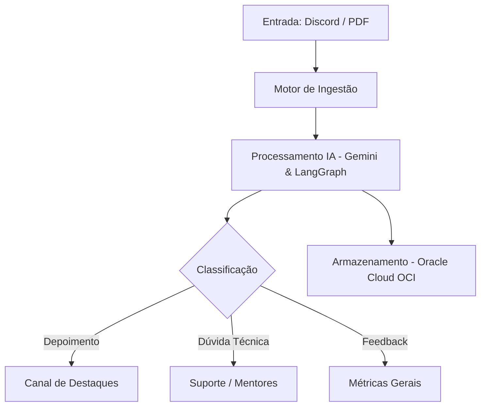

# G10-Brasil-equipo12-CommunityLab

[](https://github.com/No-Country-simulation/G10-Brasil-equipo12-CommunityLab/actions/workflows/testes.yml)

## 🏛️ Arquitetura do Sistema

O fluxo de dados do **CommunityLab** segue a seguinte estrutura:

1. **Entrada:** Captura de mensagens do Discord ou PDFs de relatórios.
2. **Motor de Ingestão:** Pré-processamento e limpeza dos dados brutos.
3. **Processamento IA:** Categorização e análise de sentimento via Gemini e LangGraph.
4. **Distribuição & Armazenamento:** Envio para canais específicos e gravação na Oracle Cloud (OCI).



## 🚦 Estado atual da implementação

| Etapa | Status |
| :--- | :--- |
| Entrada | Arquivos JSON ou CSV locais (`dados/`). Discord e PDF ainda não implementados. |
| Ingestão e limpeza | `src/ingestao.py` e `src/limpeza.py`. Cada interação recebe um `id` único. |
| Processamento IA | Groq (`openai/gpt-oss-120b`) por padrão, API da NVIDIA ou um modelo local via Ollama. Gemini e LangGraph ainda não implementados. |
| Saída | JSON validado com análise por mensagem (tipo, sentimento, tópicos, relevância) e os ativos: post de LinkedIn, destaque de newsletter, sugestão de FAQ e case de sucesso. |
| Armazenamento OCI | Ainda não implementado. O bloco `armazenamento_oci` indica o destino planejado com `status: pendente_upload`. |

## ▶️ Como rodar

Requer Python 3.10 ou mais novo.

```bash
python -m venv .venv
source .venv/bin/activate          # no Windows: .venv\Scripts\activate
pip install -r requirements-dev.txt
cp .env.example .env               # e coloque sua GROQ_API_KEY
```

### Escolhendo a LLM

| Provedor | No `.env` | Observação |
| :--- | :--- | :--- |
| Groq (padrão) | `GROQ_API_KEY` | Modelo `openai/gpt-oss-120b`. |
| API da NVIDIA | `LLM_PROVIDER=nvidia` e `NVIDIA_API_KEY` | A chave (começa com `nvapi-`) é gerada em [build.nvidia.com](https://build.nvidia.com); confira lá os limites de uso. Modelo padrão `openai/gpt-oss-20b`, trocável com `NVIDIA_MODEL`. Nem todo modelo do catálogo está liberado para toda conta ou responde bem em JSON. |
| Ollama (local) | `LLM_PROVIDER=ollama` e `OLLAMA_MODEL` | Roda no seu computador, sem chave de API. |

Executar o pipeline (o arquivo é opcional; o padrão é `dados/mensagens_exemplo.json`):

```bash
python -m src.teste_execucao dados/casos_demo.json
```

O resultado traz `status`: `sucesso`, `parcial` (com a lista de `avisos`) ou `erro`. Quando a LLM falha, o pipeline não inventa conteúdo.

Avaliar o pipeline contra os casos de demonstração (`dados/casos_demo.json`, 3 casos) ou contra o conjunto maior (`dados/casos_avaliacao.json`, 18 casos rotulados segundo [docs/criterios_rotulagem.md](docs/criterios_rotulagem.md)):

```bash
python -m src.avaliacao
python -m src.avaliacao --casos dados/casos_avaliacao.json
```

Além da acurácia por campo, a avaliação aponta post, newsletter ou case escritos em primeira pessoa ou com termos que os casos proíbem.

Rodar os testes automatizados (não chamam a LLM) e conferir lint e formatação, como o GitHub Actions faz em cada Pull Request:

```bash
pytest
ruff check src tests
ruff format --check src tests   # sem --check, formata os arquivos
```
