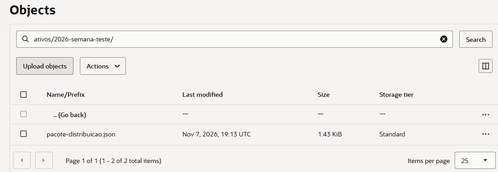
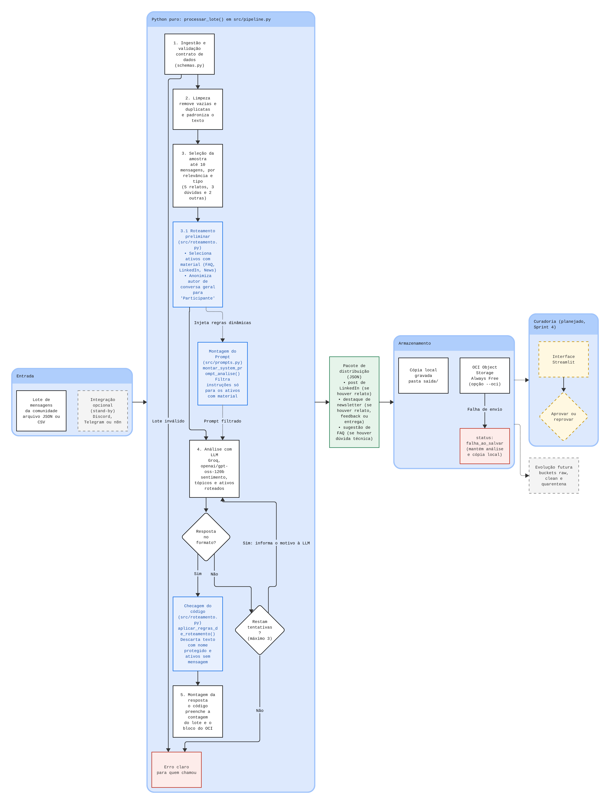

# Relatório de Execução do Fluxo Completo e Persistência OCI

**Data da Execução:** 07/11/2026  
**Ambiente:** Branch `main` (versão atualizada pós-roteamento e regras de privacidade)  
**Autor:** Denilson Silva de Almeida (Engenharia de Dados)

---

## 1. Comando Executado

O pipeline completo foi acionado via terminal com a flag de persistência na Oracle Cloud Infrastructure (`--oci`):

```bash
python -m src.pipeline dados/caso_proposta_estagio.json --oci --periodo Semana_Teste
```

---

## 2. Saída do Terminal (`status: salvo_com_sucesso`)

```json
{
  "status": "sucesso",
  "resumo_comunidade": {
    "total_interacoes_processadas": 2,
    "sentimento_predominante": "Positivo",
    "topicos_principais": [
      "proposta de estágio em engenharia de dados",
      "freela de automação"
    ]
  },
  "ativos_distribuicao_gerados": {
    "post_linkedin": {
      "titulo": "Proposta de estágio em engenharia de dados e primeiro freela de automação",
      "copy": "Duas conquistas da comunidade ONE! 🚀\n\nGustavo Prado recebeu uma proposta de estágio em engenharia de dados, depois de publicar no GitHub um pipeline com bucket na nuvem.\n\nHenrique Barros fechou seu primeiro freela de automação, usando n8n com Webhook para conectar um formulário a uma planilha, e o cliente adorou.\n\nParabéns a ambos! Qual projeto seu merece ser mostrado? Compartilhe nos comentários.\n\n#EngenhariaDeDados #Automação #CarreiraTech",
      "canal_recomendado": "LinkedIn Oficial",
      "potencial_engajamento": "Alto"
    },
    "destaque_newsletter_semanal": {
      "secao": "Vitória da Semana",
      "chamada": "Gustavo recebe proposta de estágio em engenharia de dados",
      "resumo": "Gustavo Prado recebeu uma proposta de estágio em engenharia de dados após publicar no GitHub um pipeline com bucket na nuvem. Henrique Barros fechou seu primeiro freela de automação usando n8n e Webhook. Quer mostrar seu projeto? Conte em #conquistas-e-vagas."
    },
    "sugestao_conteudo_faq": null
  },
  "armazenamento_oci": {
    "bucket": "communitylab-ativos-marketing",
    "caminho_objeto": "ativos/2026-semana-teste/pacote-distribuicao.json",
    "status": "salvo_com_sucesso"
  }
}
```

> **Cópia local gerada:** `saida/2026-semana-teste_pacote-distribuicao.json`

---

## 3. Comparação: Arquivo no Bucket OCI vs Cópia Local em `saida/`

- **Conteúdo de Negócio:** Idêntico (100% de paridade nos ativos de marketing: LinkedIn, Newsletter e tópicos extraídos).
- **Diferença Estrutural:** A única diferença é a presença do bloco `armazenamento_oci` na cópia local em `saida/`, que registra o metadado da confirmação do upload (`status: salvo_com_sucesso`, bucket de destino e caminho da partição). No payload enviado ao bucket, o objeto contém os ativos gerados sem auto-referência cíclica ao próprio status de envio.

---

## 4. Evidência no Bucket OCI (Console Web)

Persistência validada no Object Storage da Oracle Cloud no caminho `ativos/2026-semana-teste/pacote-distribuicao.json`:



*(Observação: Informações sensíveis de tenancy, namespace e OCIDs foram omitidas conforme boas práticas de segurança).*

---

## 5. Resiliência e Diagrama de Arquitetura

Caso ocorra indisponibilidade ou falha na integração com o OCI Object Storage, o pipeline:
1. Trata a exceção sem interromper a execução do motor.
2. Registra o status `"falha_ao_salvar"` no metadado `armazenamento_oci`.
3. Garante que os dados gerados pela análise da LLM permaneçam íntegros e salvos na cópia local em `saida/`.

O diagrama abaixo reflete a arquitetura atualizada da `main`, detalhando as etapas de pré/pós-roteamento, privacidade, e o fluxo de persistência e erro OCI:



---

## 📌 Resumo / Checklist de Validação das Entregas

| Item | Solicitação | Status | Observação |
| :--- | :--- | :---: | :--- |
| **1** | **Saída do terminal com `salvo_com_sucesso`** | ✅ Concluído | Seção 2 deste relatório (execução na `main`). |
| **2** | **Comparação Bucket OCI vs Cópia Local** | ✅ Concluído | Seção 3 (conteúdo idêntico, metadado na cópia local). |
| **3** | **Novo print do Bucket sem dados sensíveis** | ✅ Concluído | Seção 4 (print de 07/11/2026, 19:13 UTC). |
| **4** | **Diagrama de fluxo atualizado** | ✅ Concluído | Seção 5 (diagrama exportado do Miro com fluxo de erro OCI). |